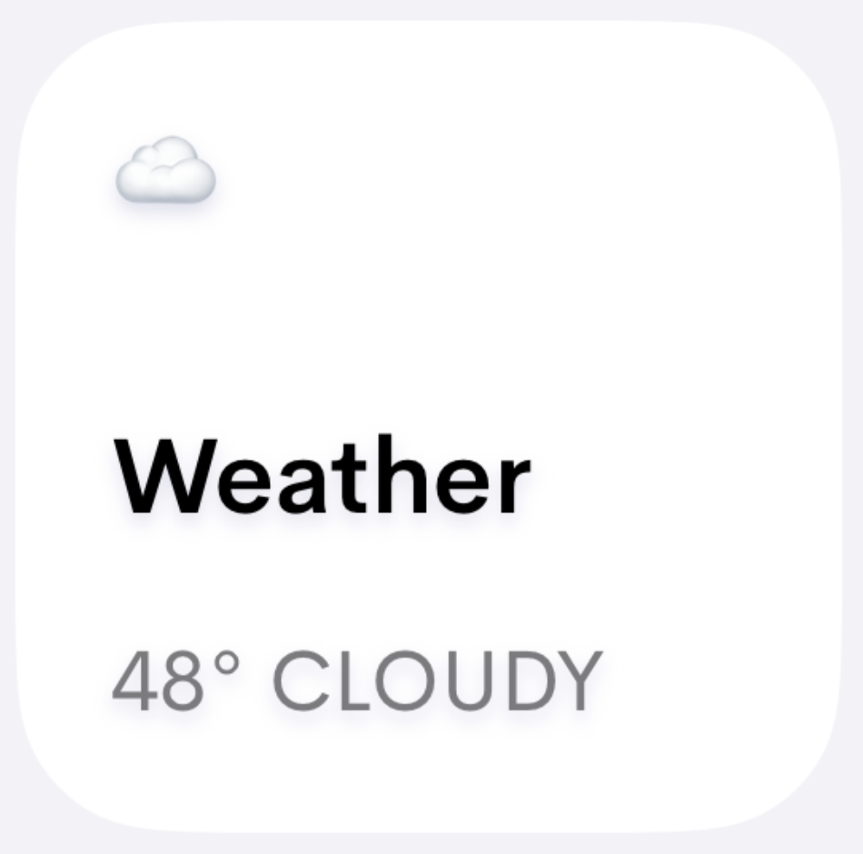

# Weather forecast driver for Crestron Home

A Crestron Home (4-Series) extension driver that adds a Weather tile, forecast pages and
weather events for scenes. It uses a free Open-Meteo forecast and updates every 30 minutes.

The tile layout is limited by Crestron.

The driver needs internet access from the processor. It is not affiliated with Crestron
or Open-Meteo.

## What you get in Crestron Home

- A **Weather tile** on the Home page and on selected room pages. Its line always starts with the
  current temperature, followed by an active wind alert ("49° Gusts 41 mph"), else rain
  or snow expected within 3 hours ("49° Snow from 4 PM"), else the condition
  ("49° Partly cloudy"). Room tiles show a weather symbol in the corner; the Home tile
  shows the nearest Crestron icon.
- A **Weather page**: a temperature gauge, today's high/low, wind, gusts, precipitation
  and humidity, sunrise and sunset, a "Coming up" card with a one-line summary of the
  next 24 hours and of the next 5 days ("Rain, turning to snow around 6 PM"), and
  buttons for the forecast pages.
- **Next 24 hours** (twelve cards, two hours apart) and **5-day forecast** pages.
- An **Alert settings** page for the homeowner: wind alert and its gust limit, freeze
  alert, rain and snow heads-up.
- **Events** for scenes and sequences (Actions & Events):

  | Event | Raised when |
  | --- | --- |
  | Rain or Snow Expected | Rain or snow becomes 50% or more likely within 3 hours |
  | Wind Gusts Above Limit | Current gusts reach the limit on the Alert settings page |
  | Wind Gusts Back Below Limit | Gusts drop back under it |
  | Freeze Expected Tonight | Once per evening, from 3 PM, when the coldest hour before 9 AM is at or below 32 °F (0 °C) |
  | Hot Day Ahead | Once per day when today's high is 90 °F (32 °C) or more |
  | Forecast Lost | No successful update for 3 hours |
  | Forecast Restored | Updates resume after that |

- One **scene step**: Refresh Forecast.

## Install

1. Copy `Weather_LaunchControl_Forecast_IP.pkg` to the processor folder
   `/user/ThirdPartyDrivers/Import` (Crestron Toolbox File Manager, or SFTP).
   The path is case sensitive.
2. In Crestron Home Configure Pro, add a device, select the room you would like it to appear in. In Device Type, select **Drivers** > **Weather Station** >  **LaunchControl** > **Weather Forecast**.
3. Enter the **Location**: a city with its state or country (`Park City, UT`,
   `Toronto, Canada`), or a latitude and longitude (`40.6461, -111.4980`). A place that
   cannot be found is reported on this step.
4. Optionally enter a **Name to show**, choose the **Units**.

The tile appears on the Home page and that room's page.

## Open-Meteo and commercial use

With no API key the driver uses Open-Meteo's free service, which Open-Meteo offers for
non-commercial use. For installations you are paid for, subscribe to an Open-Meteo API
plan and enter the key in the device settings; the driver then uses Open-Meteo's
customer servers (`customer-api.open-meteo.com`). The Alert settings page shows which
service is in use. The forecast is fetched every 30 minutes, about 48 requests a day.

## How the tile is put together, and its limits

Crestron Home draws the tile; the driver only fills four slots. What was learned from a
real system:

- **Title.** The bold title is the device's name in Crestron Home, not something the
  driver sets, so the driver cannot remove or change it. Rename the device in the Setup
  app to make it earn its place: the town ("Seattle") reads well above "49° Partly cloudy".
- **Status line.** Drawn in capitals on two lines of about twelve characters, then cut off.
  The driver keeps every line it can produce inside that (`tests\` checks all of them),
  which is why it is the temperature plus two short words and no high/low.
- **Corner of a room tile.** Shows text in place of an icon. The driver puts a weather
  symbol character there (sun, sun behind cloud, cloud, rain cloud, snow cloud, thunder
  cloud, fog, moon, wind), which phones and tablets draw as a picture.
- **Corner of the Home tile.** Shows an icon from Crestron Home's built-in set only, and
  that set (336 icons) has no cloud, fog or moon. The driver uses the sun for sunny and
  mostly sunny, a smaller sun for partly cloudy, drops for rain, a snowflake for snow, a
  bolt for thunder, the warning icon for a wind alert and the general climate icon for
  everything else, night included.

## Troubleshooting

- The tile reads **No forecast** and the Weather page says why: no location yet, the
  place was not found, or the service could not be reached. The driver retries after
  1, 2, 5, 10 and then every 15 minutes.
- **Could not reach ...** on the settings step or the Weather page names the server and
  the underlying cause. Check that the processor can reach `api.open-meteo.com` and
  `geocoding-api.open-meteo.com` on port 443.
- A forecast older than 3 hours is not shown; the tile then reads "No forecast since"
  with the time of the last update.
- For driver logs, open a console to the processor (Toolbox Text Console or SSH), run
  `ch logger drivers` to list drivers, then raise this driver's level to `debug`.
- Times are shown in the forecast location's own time zone, in 12-hour form.
